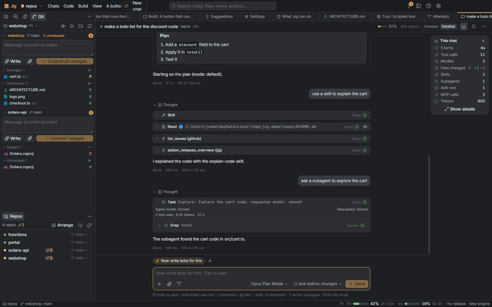
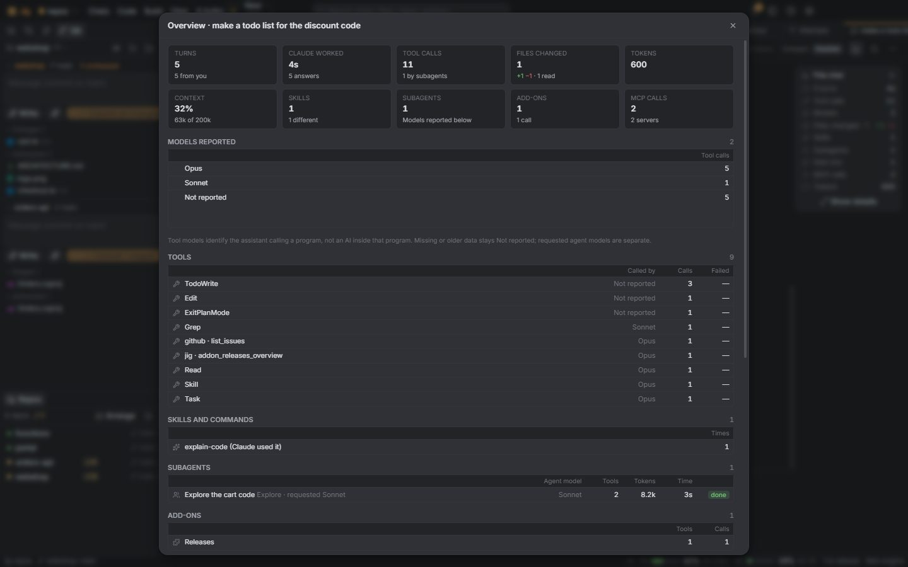

# Chat reference

The chat is meant to do everything Claude Code's own terminal UI does, and more. Code:
`apps/desktop/src/renderer/features/sessions/` (Composer, ComposerPicker, composerInput, Transcript,
ToolCard, PermissionCard, ChatPanels, SessionDialogs, menus), host side in `main/sessions/` and
`main/engine/` (`docs/reference/engine.md`). Decision: D-091.

## Claude Code next to Jig

Model pickers use stable family aliases: Opus (`opus`), Sonnet (`sonnet`), Haiku (`haiku`) and
Opus Plan Mode (`opusplan`). Discovery may report a versioned display name for an alias; Jig keeps
the short name and sends the alias unchanged. Explicit version choices remain available separately.
New chats inherit the project's model when set, otherwise `engine.defaultModel`. The engine's
resolved active model is recorded separately and never replaces the selected alias (D-195).

| Claude Code (terminal) | Jig |
| --- | --- |
| `/` commands and skills | `/` in the message box opens a picker of Claude Code's own commands and skills (`sessions.commands`, from the running Claude Code, cached per folder). The **+** button → Commands and skills does the same |
| `/model`, `/permissions`, `/mcp`, `/add-dir`, `/export`, `/clear`, `/rewind` | the same names in the picker open Jig's menus and dialogs (model and effort menu, permission menu, MCP servers dialog, folders dialog, export, new chat, the message menu). Commands that only make sense in a terminal (`/login`, `/config`, `/vim`, `/exit`…) are left out |
| `@` file mentions | `@` opens a fuzzy file and folder picker (`files.search`: git's file list inside repositories, a walk elsewhere that skips `node_modules`, build output and caches). Folders keep the picker open to go deeper. Mentions that point at something (a file that exists, a folder, a meeting) are highlighted in the box (a layer drawn behind the textarea) and get a chip above it: click opens it (Preview, the file manager, Meetings), × takes it out; Ctrl/Cmd+click on the mention in the text opens it too (D-253) |
| `!` bash mode | `! command` runs in the chat's folder (PowerShell on Windows, `$SHELL` elsewhere, 2 minutes at most). The output shows as a card and goes to Claude with your next message as `<bash-input>`/`<bash-stdout>`, like Claude Code |
| `#` memory | `# text` → Enter asks which CLAUDE.md: the chat folder's or `~/.claude/CLAUDE.md`; a line `- text` is appended |
| ↑ / ↓ history | your earlier messages of this chat (↑ on the first line of an empty box; a recalled `/command` doesn't open the picker) |
| Shift+Tab modes | Ask before changes → Accept edits → Plan only → Ask. The mode shows on a button in the box's bottom row, first of permission › provider › model (icon and label at their natural width, only the icon in a narrow box; red for Don't ask, the accent for the others but Ask, D-364, D-392); the button opens the modes; no line above the box (Jon); plan mode outlines the box |
| Esc | stops Claude |
| A terminal Claude started ends | Jig tells the chat (D-281): one muted line "Terminal "…" finished" / "failed with exit code N" with "Jig told Claude"; it starts a turn, or joins the running one. Not editable, not in ↑ history |
| The task queue asks for a task's report | the same muted line with the Tasks add-on's icon, "Task queue: asked for the report of task N" (D-318, `chats.send` with `from`); the request itself is in its tooltip |
| Typing while Claude works | Enter queues the message for after the turn (the list above the box; click a queued message to edit it in a dialog with the same message box: attachments with ×, the + menu, paperclip, dictation, pasting and dropping files, `@` and `/` pickers, but none of the chat's controls; Ctrl+Enter saves the text and files back in the same place, D-308; × removes it). **Ctrl+Enter** (or Send now in the Send menu, ⚡ on a queued row) sends it now: it joins the running turn and Claude reads it at its next step (`priority: "next"`) |
| Send menu (D-365) | the chevron beside Send: Send / Queue: after this turn (Enter), Send now: into the running turn (Ctrl+Enter, only while working), Park: keep it, send it later (**Alt+Enter**), Send in a new chat (same project, files copied). Always there, so nothing moves |
| Parked messages (D-365) | kept with the chat (saved, survive restarts), never sent by themselves; shown under the queue as "Parked" (muted, dashed, the pause icon). Click a row to edit it; its buttons send it (queue it while working), send it now (while working) or remove it; a queued row's pause button parks it |
| Esc Esc / `/rewind` | your message's ⋯ → **Edit and send again** or **Rewind to before this message** (the chat; the chat and the files; or only the files). The transcript drops the message and what came after, the text goes back into the box, and the next message continues the conversation from the turn before (`resumeSessionAt`), or starts a new one when it was the first message |
| Todo list | TodoWrite shows as a checklist in the chat, and the current list stays above the box while it has open items |
| Plan approval | ExitPlanMode is a plan card: Approve and accept edits, Approve and ask before edits, or Keep planning with feedback |
| Edit diffs | Edit/Write cards show the diff (from Claude Code's structured patch) with +/− counts; long diffs fold |
| Bash output | the first lines under the card; click for all of it. Running tools show how long they've run |
| Subagents | Task/Agent cards show progress: tool uses, tokens, time, the tool it's using, and its summary; its own tool calls are inside |
| Ctrl+B background | ⤓ on a running Bash or Task card moves it to the background; background commands and agents are listed above the box with Stop |
| `/mcp` | chat ⋯ → MCP servers…: status (connected, failed, needs sign-in, off), tools, on/off, reconnect. A server that fails at start adds a notice in the chat |
| `/add-dir` | chat ⋯ → Folders for this chat…: other folders Claude may use (Claude Code restarts with them at the next message) |
| `/model`, effort | the model menu (bottom row of the message box) lists Claude Code's models (`sessions.models`) and an Effort submenu for models that support it (`sessions.setEffort`, applied to the running session); the permission mode is its own button before the provider picker (D-364, D-392) |
| `/export` | chat ⋯ → Export as Markdown… (`shared/chatExport.ts`) |
| `/context`, `/compact`, `/usage` | the context meter, Compact, the plan usage ring (`docs/reference/engine.md`) |

## Beyond the terminal

- **A chat's project is the active project** (D-163): selecting a chat in the Chats list, or bringing
  its tab to the front (a tab, Home, a notification), makes its project the active one; a chat
  without a project changes nothing. Moving a chat to another project, or choosing a project while
  the chat stays open, leaves your choice alone.
- **Claude's questions** (AskUserQuestion) are asked one at a time (D-161): a strip of the steps
  (green once answered; click one to go back), the question with its options as rows — a circle for
  one choice, a square for several, a "Recommended" badge, "Something else…" with its own field —
  then Back, Skip and Next; the last step's Answer sends every answer to Claude together. Once
  answered, the card is a summary of what you said.
- **Compact or Detailed** (switch in the chat's top bar; setting `chat.view`, D-159): Compact, the
  default, shows what you and Claude say, with each run of steps between (commands, reads, edits,
  searches, agents, thinking) folded into one line — "Ran 3 commands, read a file, edited cart.ts
  +4 −1", a single command's description, failures counted, a spinner and the current step while
  it runs (the latest line keeps its spinner and says Working between steps while the chat works); click it for the cards. Subagents' hand-backs in chats opened from Claude Code are a
  step too ("Message from subagent"). Questions,
  permission prompts, plans, results and notices stay in view. The whole-chat changes row stays
  above the input. Detailed shows every step as its card. Find in chat opens the line that holds a match.
- **An empty chat** shows where Claude runs, starter prompts (a click puts one in the box) and the
  message box's shortcuts.
- **Message actions on hover:**
  - your messages: Edit and send again, Copy, and ⋯ (rewind, restore files, add-on entries);
  - Claude's answers: Copy and ⋯.
- **Whole-chat changes** (D-204): one fixed-height row above the composer, outside the scrolling
  transcript. It shows **X files changed**, accumulated +/− line counts,
  **Walk me through** (the first listed repository's tour) and **Undo changes**. The row's space
  is reserved before any edits; it scrolls horizontally at narrow widths instead of wrapping.
  Clicking the count opens a modal snapshot of the whole chat's file edits: full paths, edit
  counts and aligned +/− columns. File paths open Preview. The modal has a bounded scrolling list.
  Counts include successful recorded Edit/MultiEdit/Write/NotebookEdit calls, including subagents,
  across every turn; repeated paths are combined. Running and failed calls are excluded. Counts
  sum captured edit hunks, not a current Git diff; shell-only changes may be absent. Restoring files
  preserves the recorded history; rewinding the transcript removes the rewound edits from totals.
  Undo previews and confirms restoration to the first message's checkpoint; it is disabled while
  working or when that checkpoint is unavailable. `ChatChanges.tsx` shares `chatStats()` with the
  overview, keeping both displays consistent. No per-turn changed-files cards remain.
  Checkpoint restoration changes local file contents only, leaving commits/pushed history intact;
  it can replace later edits. Review and commit the resulting diff to record a restoration.
- **A tool waiting for your permission** says "waiting for you" instead of a spinner, and can't go to
  the background until it runs.
- **"Don't ask" waits a minute, then declines (D-293, D-336):** Claude Code still asks for its own
  safety checks in that mode (`rm -rf` on a drive root or the home folder…). Jig shows the permission
  card with a countdown (`declineAt` on the item; the chat is "Needs you") for
  `engine.dontAskWaitSeconds` (default 60). Unanswered, `askPermission` in
  `main/sessions/manager.ts` declines it, tells Claude to do it a safer way or skip it, and the card
  becomes a warning notice (`timedOut` on the item). With 0 it declines at once with that notice.
  Questions (`AskUserQuestion`, `ExitPlanMode`) just wait for you.

- **Project** (beside the title in the header, D-341): until the first message a picker that moves the
  new chat to another project with that project's folder and defaults; the chat in front also follows
  the top bar's project. Afterwards plain text in the same box.
- **Times** (clock button in the header, setting `chat.times`, D-306): every message and step gets its
  time in a fixed column at the left, with the day when it changes; a turn's "Done" line has none. The
  tooltip gives the time to the second and how long after the previous step. Off, the time shows in a
  message's hover toolbar and in a steps line's tooltip.
- **Chat overview** (chart button in the header, setting `chat.overview`, D-184): a small card at the
  top right of the chat, in its own reserved column beside the conversation (D-189). The transcript,
  queue and composer share a column and matching content edges. The overview's space stays reserved
  when hidden and before the first message, so showing it never shifts the conversation. It shows
  turns and time Claude worked, tool calls, files changed (+/−),
  skills, subagents, add-ons, MCP calls, tokens and cost ("—" without an estimate, e.g. ChatGPT
  chats). Tokens and cost are shown only here, not in the chat's header. An add-on is used when
  Claude calls one of its tools or Jig's tools for its data. **Show details** (or ⋯ → Chat overview…) opens a modal: tiles, then
  tables of tools (calls, failed), skills and commands, subagents (tools, tokens, time, status),
  add-ons, MCP servers, files changed (click to preview), activity (commands, `!` commands, web,
  thinking, permissions) and tokens. The counting is `chatStats()` in `shared/chatStats.ts`, computed
  from the transcript, nothing extra recorded.

  
  

- **Find in chat** (Ctrl+F, or 🔍 in the header): matches in messages, tool calls, outputs and plans,
  newest first; Enter / Shift+Enter step, the transcript scrolls to each.
- **Jump to latest** when you've scrolled up.
- Images from tools, previews of files Claude touched, next-message suggestions, fork, restore files,
  Try several ways, Claude's terminals and browser (`docs/reference/ai-features.md`).
- Notices for Claude's API retries ("answered 529; retries in 4 s"), Claude Code's warnings,
  permission-rule denials, requests declined in "Don't ask" mode, and MCP servers that need you.

## Fake engine

`/name` (a command prints, a skill answers), "todo list", "make a plan", "subagent",
"background job", "edit <file>" (`e2e/chat-parity.spec.ts`).

Model attribution (D-197): Detailed tool cards show their reported caller model in a fixed column.
Agent cards also reserve a line for reported child model(s) and separately show an explicit requested
model. Compact mode omits these annotations. The overview's Models row opens into the details'
reported-model/tool-call totals, caller-model column and agent-model column. Full reported ids are
in tooltips. A tool is a program: these labels identify the calling assistant, not a hidden model
inside an MCP server. Older/missing metadata stays Not reported.
